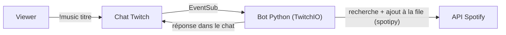

# SpotyBot

Bot Twitch écrit en **Python** qui permet aux viewers de demander des musiques directement dans le chat. Quand un viewer tape `!music nom de la chanson`, le bot cherche le morceau sur Spotify et l'ajoute à la **file de lecture Spotify du streamer**.

- **[TwitchIO 3](https://twitchio.dev)** : création du bot, lecture et écriture dans le chat Twitch (EventSub), gestion des autorisations OAuth.
- **[spotipy](https://spotipy.readthedocs.io)** : gestion de l'API Spotify (recherche, file de lecture, renouvellement automatique du token).
- **[uv](https://docs.astral.sh/uv/)** : installation des dépendances et lancement du script, sous Linux comme sous Windows.

> **Modèle d'utilisation** : chaque streamer héberge **sa propre instance** du bot, avec sa propre application Twitch et sa propre application Spotify. Il n'y a pas de serveur central partagé. Les identifiants de chacun restent donc chez lui.

## Sommaire

- [Fonctionnalités](#fonctionnalités)
- [Comment ça marche](#comment-ça-marche)
- [Prérequis](#prérequis)
- [Installation pas à pas](#installation-pas-à-pas)
- [Gérer la partie Spotify](#gérer-la-partie-spotify)
- [Déploiement](#déploiement)
- [Gestion des dépendances avec uv](#gestion-des-dépendances-avec-uv)
- [Sécurité](#sécurité)
- [Dépannage](#dépannage)

## Fonctionnalités

| Commande | Qui | Effet |
|---|---|---|
| `!music <titre ou artiste + titre>` | Tout le monde | Cherche le morceau sur Spotify et l'ajoute à la file de lecture. |
| `!queue` | Tout le monde | Affiche les prochains morceaux de la file Spotify. |

Détails utiles :

- Le bot répond avec le **titre officiel trouvé par Spotify** (« Artiste - Titre »), pas avec le texte tapé par le viewer.
- **Anti-doublon** : un morceau déjà présent dans la file, ou en cours de lecture, est refusé. La comparaison se fait sur l'identifiant Spotify, mais aussi sur le couple titre + artiste, pour éviter qu'une autre version du même morceau passe.
- Messages d'erreur clairs dans le chat : aucun résultat, aucune lecture Spotify active, compte non Premium, Spotify indisponible.
- `!queue` affiche aussi les prochains titres de la playlist ou de l'album en cours, car c'est ce que renvoie Spotify.

## Comment ça marche



1. Twitch envoie au bot chaque message du chat (abonnement EventSub créé au moment de l'autorisation).
2. Le bot analyse la commande `!music`, cherche le morceau via Spotify, vérifie qu'il n'est pas déjà dans la file, puis l'ajoute.
3. Les tokens Twitch sont stockés dans une base SQLite locale (`tokens.db`), et le token Spotify dans `.cache`. Après la première autorisation, tout se renouvelle automatiquement.

## Prérequis

- **Python 3.11 ou plus** (uv peut l'installer pour vous).
- **[uv](https://docs.astral.sh/uv/)**.
- **Git** (nécessaire pour installer la dépendance `asqlite` depuis GitHub).
- Un **compte Twitch pour le bot** (recommandé : un compte dédié, voir la FAQ plus bas).
- Votre compte Twitch de streamer, avec la **double authentification (2FA)** activée, car Twitch l'exige pour créer une application.
- Un compte **Spotify Premium**. Le Premium est nécessaire pour contrôler la lecture à distance, et Spotify l'exige aussi du propriétaire d'une application en Development Mode.
- Un ordinateur ou serveur qui reste allumé pendant vos streams.

## Installation pas à pas

### 1. Installer uv et récupérer le projet

**Linux / macOS**

```bash
curl -LsSf https://astral.sh/uv/install.sh | sh
```

**Windows (PowerShell)**

```powershell
powershell -ExecutionPolicy ByPass -c "irm https://astral.sh/uv/install.ps1 | iex"
```

Fermez puis rouvrez le terminal, puis :

```bash
git clone https://github.com/synterion/spotybot.git
cd spotybot
uv sync
```

`uv sync` crée l'environnement virtuel et installe toutes les dépendances. Rien d'autre à installer.

### 2. Créer l'application Twitch

1. Sur [dev.twitch.tv/console](https://dev.twitch.tv/console), cliquez sur **Register Your Application** (connectez-vous avec votre compte streamer, 2FA activée).
2. Renseignez :
   - **Name** : le nom qui s'affichera sur l'écran d'autorisation.
   - **OAuth Redirect URLs** : `http://localhost:4343/oauth/callback`
   - **Category** : *Chat Bot*
   - **Client Type** : *Confidential*
3. Validez, puis notez le **Client ID** et générez un **Client Secret** (cliquez sur *New Secret*).

### 3. Préparer les comptes Twitch

**Compte du bot (recommandé : un compte dédié).** Créez un compte Twitch avec le nom que vous voulez voir apparaître dans le chat (par exemple `SpotyBot`) et **vérifiez son adresse e-mail**. Le nom affiché par le bot dans le chat est celui de ce compte, il n'existe pas de réglage séparé.

Il vous faut deux identifiants numériques :

- `TWITCH_BOT_ID` : l'ID du compte du bot.
- `TWITCH_OWNER_ID` : l'ID de votre compte de streamer.

Pour retrouver un ID à partir d'un pseudo, consultez la FAQ de TwitchIO ou utilisez un outil en ligne de type « Twitch username to ID ».

### 4. Créer l'application Spotify

Voir la section [Gérer la partie Spotify](#gérer-la-partie-spotify) ci-dessous, puis revenez ici.

### 5. Configurer les identifiants

Copiez le fichier d'exemple :

```bash
cp .env.example .env          # Linux / macOS
copy .env.example .env        # Windows (cmd)
```

Contenu de `.env` :

```env
# Application Twitch (console développeur)
TWITCH_CLIENT_ID=votre_client_id
TWITCH_CLIENT_SECRET=votre_client_secret
TWITCH_BOT_ID=id_du_compte_bot
TWITCH_OWNER_ID=id_de_votre_compte_streamer

# Application Spotify (dashboard développeur)
SPOTIPY_CLIENT_ID=votre_client_id_spotify
SPOTIPY_CLIENT_SECRET=votre_client_secret_spotify
SPOTIPY_REDIRECT_URI=http://127.0.0.1:8888/callback
```

> Le fichier `.env` contient des secrets : il ne doit **jamais** être publié sur GitHub (il est exclu par le `.gitignore` fourni).

### 6. Premier lancement

```bash
uv run --env-file .env bot.py
```

Au tout premier démarrage :

1. **Spotify** : le navigateur s'ouvre pour vous demander d'autoriser l'application. Connectez-vous et acceptez. Un fichier `.cache` est créé, et vous n'aurez plus à le refaire.
2. **Laissez le script tourner** : un petit serveur web local écoute sur `http://localhost:4343`. Vous devriez voir dans le terminal `Successfully logged in as: ...`.

### 7. Autoriser le bot sur Twitch (une seule fois)

Pendant que le script tourne :

**a) Compte du bot.** Dans une fenêtre de **navigation privée**, connectez-vous à Twitch avec le **compte du bot**, puis ouvrez :

```
http://localhost:4343/oauth?scopes=user:read:chat%20user:write:chat%20user:bot&force_verify=true
```

Cliquez sur **Autoriser**. Le terminal affiche `Added token to the database for user: ...`.

**b) Votre chaîne.** Dans votre navigateur normal, connecté avec **votre compte de streamer**, ouvrez :

```
http://localhost:4343/oauth?scopes=channel:bot&force_verify=true
```

Cliquez sur **Autoriser**. C'est à ce moment que le bot s'abonne au chat de votre chaîne.

**c) Recommandé : nommer le bot modérateur.** Dans votre chat :

```
/mod NomDuBot
```

Cela évite que Twitch limite ou bloque ses messages.

### 8. Tester

Ouvrez Spotify sur un appareil et lancez un morceau, puis tapez dans votre chat :

```
!music Daft Punk - One More Time
```

Le bot doit répondre que le morceau a été ajouté, et celui-ci doit apparaître dans la file Spotify. Vous pouvez ensuite essayer `!queue`.

Aux lancements suivants, aucune autorisation n'est nécessaire : les tokens sont rechargés depuis `tokens.db` et `.cache`.

## Gérer la partie Spotify

### Créer l'application Spotify

1. Allez sur le [dashboard développeur Spotify](https://developer.spotify.com/dashboard) et cliquez sur **Create app**.
2. Renseignez un nom et une description, puis dans **Redirect URIs** ajoutez exactement :
   ```
   http://127.0.0.1:8888/callback
   ```
   L'URI doit être **strictement identique** à celle de `SPOTIPY_REDIRECT_URI` : même port, pas de slash final, `http` et non `https`. Spotify n'accepte plus `localhost` pour les nouvelles URI, utilisez `127.0.0.1`.
3. Cochez **Web API** comme API utilisée, acceptez les conditions et enregistrez avec **Save**.
4. Dans **Settings**, récupérez le **Client ID** et le **Client secret**.

### Droits demandés

Le bot demande à Spotify deux permissions (*scopes*) :

- `user-modify-playback-state` : ajouter un morceau à la file de lecture.
- `user-read-playback-state` : lire la file pour `!queue` et l'anti-doublon.

Si vous modifiez ces scopes plus tard, supprimez le fichier `.cache` pour relancer l'autorisation.

### Règles Spotify à connaître

- **Premium obligatoire.** Le compte propriétaire de l'application doit être Premium (règle de Spotify pour les applications en Development Mode), et le compte dont on contrôle la lecture aussi.
- **Development Mode.** Seuls les comptes ajoutés dans **User Management** de l'application peuvent s'y connecter, et leur nombre est limité par Spotify. Si votre compte Spotify n'est pas celui qui a créé l'application, ajoutez-le (nom et e-mail du compte Spotify).
- **Un appareil Spotify doit être actif.** L'API ne peut ajouter un morceau que si Spotify est ouvert (ordinateur, téléphone, enceinte connectée) et a joué quelque chose récemment. Sinon le bot répond « Aucune lecture Spotify active ». Lancez donc un morceau avant de démarrer le stream.
- **Le bot agit sur le compte qui a autorisé l'application.** Les morceaux demandés vont dans la file de ce compte, quelle que soit la personne qui les demande dans le chat.

## Déploiement

Le bot doit tourner **en continu** pendant vos streams. Commencez toujours par le [premier lancement](#6-premier-lancement) sur une machine avec navigateur, afin de créer `tokens.db` et `.cache`.

### Linux (service systemd)

Créez `/etc/systemd/system/spotybot.service` (adaptez `USER` et les chemins ; `which uv` donne le chemin de uv) :

```ini
[Unit]
Description=SpotyBot (bot Twitch + Spotify)
After=network-online.target
Wants=network-online.target

[Service]
Type=simple
User=USER
WorkingDirectory=/home/USER/spotybot
ExecStart=/home/USER/.local/bin/uv run --env-file .env bot.py
Restart=on-failure
RestartSec=10

[Install]
WantedBy=multi-user.target
```

Puis :

```bash
sudo systemctl daemon-reload
sudo systemctl enable --now spotybot
sudo systemctl status spotybot
journalctl -u spotybot -f        # suivre les logs en direct
```

Le `WorkingDirectory` est important : `.cache` et `tokens.db` sont lus depuis ce dossier.

### Windows

Lancement manuel, depuis le dossier du projet :

```powershell
uv run --env-file .env bot.py
```

Démarrage automatique avec le **Planificateur de tâches** :

1. Créer une tâche de base, déclencheur **À l'ouverture de session** (ou au démarrage).
2. Action : *Démarrer un programme*.
   - Programme : le chemin de `uv.exe` (`where uv` dans PowerShell).
   - Arguments : `run --env-file .env bot.py`
   - **Commencer dans** : le dossier du projet (obligatoire, pour retrouver `.env`, `.cache` et `tokens.db`).
3. Dans les propriétés, cochez *Exécuter même si l'utilisateur n'est pas connecté* si vous le souhaitez.

### Serveur sans navigateur (VPS)

Les autorisations (Twitch et Spotify) se font dans un navigateur. Deux solutions :

- **Autoriser en local, puis copier** : faites le premier lancement sur votre PC, puis copiez `tokens.db` et `.cache` dans le dossier du projet sur le serveur.
- **Tunnel SSH** : depuis votre PC, redirigez les ports du serveur, puis ouvrez les liens d'autorisation normalement dans votre navigateur :
  ```bash
  ssh -L 4343:localhost:4343 -L 8888:localhost:8888 utilisateur@serveur
  ```

Aucun port n'a besoin d'être ouvert au public : le serveur web du bot n'est utilisé que pour les autorisations.

## Gestion des dépendances avec uv

Le projet déclare ses dépendances dans `pyproject.toml`, et `uv.lock` fige les versions exactes. Il n'y a **rien à installer à la main** :

```bash
uv sync                  # installe tout (crée .venv automatiquement)
uv run bot.py            # lance le bot (resynchronise si besoin)
```

Exemple de `pyproject.toml` :

```toml
[project]
name = "spotybot"
version = "0.1.0"
requires-python = ">=3.11"
dependencies = [
    "twitchio>=3",
    "spotipy",
    "asqlite @ git+https://github.com/Rapptz/asqlite.git",
]
```

Pour partir de zéro ou ajouter une dépendance :

```bash
uv init
uv add twitchio spotipy
uv add git+https://github.com/Rapptz/asqlite.git
```

Pour mettre à jour : `uv lock --upgrade` puis `uv sync`. Pensez à publier `uv.lock` sur GitHub pour des installations reproductibles.

## Sécurité

- **Ne publiez jamais** `.env`, `.cache` ni `tokens.db`. Ajoutez au `.gitignore` :
  ```gitignore
  .env
  .cache
  tokens.db
  .venv/
  __pycache__/
  ```
- Fournissez un `.env.example` (sans vraies valeurs) pour documenter la configuration.
- Si un secret a été publié par erreur, **régénérez-le** immédiatement (*New Secret* dans la console Twitch, *Reset secret* dans le dashboard Spotify), puis supprimez les tokens associés. Retirer le fichier d'un commit ne suffit pas, il reste dans l'historique Git.
- Pour révoquer les accès : [twitch.tv/settings/connections](https://www.twitch.tv/settings/connections) côté Twitch et [spotify.com/account/apps](https://www.spotify.com/account/apps) côté Spotify.

## Dépannage

| Symptôme | Cause probable et solution |
|---|---|
| `INVALID_CLIENT: Invalid redirect URI` ou `redirect_uri: Not matching configuration` | L'URI du dashboard Spotify n'est pas identique à `SPOTIPY_REDIRECT_URI`. Vérifiez port, slash final, `http`, et cliquez sur **Save**. |
| Le bot ne réagit à aucun message, rien dans le terminal | L'abonnement au chat n'existe pas : refaites l'étape 7b pendant que le script tourne et cherchez un `Failed to subscribe` dans les logs. |
| Le terminal affiche le message mais le bot ne répond pas | Vérifiez l'étape 7a (autorisation avec le compte **du bot**, scopes `user:write:chat` et `user:bot`), l'e-mail vérifié du compte bot, et passez-le modérateur. |
| « Aucune lecture Spotify active » | Aucun appareil Spotify actif. Ouvrez Spotify et lancez un morceau. |
| « Spotify refuse l'action » (403) | Le compte Spotify n'est pas Premium, ou n'est pas dans le User Management de l'application. |
| `429 Too Many Requests` sur `helix/chat/messages` | Le bot envoie plusieurs messages en un instant. Vérifiez qu'une commande n'envoie qu'**un seul** `ctx.reply` par exécution, et qu'une seule instance du bot tourne (`pgrep -af bot.py` sous Linux). |
| Port 4343 déjà utilisé | Une autre instance tourne déjà. Arrêtez-la avant de relancer. |
| Les autorisations semblent s'écraser entre elles | Les tokens Twitch sont enregistrés par compte. Pour repartir proprement : arrêtez le bot, supprimez `tokens.db` et `.cache`, relancez, puis refaites les autorisations. |
| Warning `Starlette adapter` au démarrage | Sans gravité : le bot utilise l'adaptateur aiohttp, installé avec TwitchIO. |

### Repartir de zéro

```bash
# bot arrêté
rm tokens.db .cache          # Windows : del tokens.db .cache
```

Pensez aussi à déconnecter l'application sur Twitch et Spotify (liens de la section Sécurité), puis refaites les autorisations.

## FAQ

**Puis-je utiliser mon compte principal comme compte du bot ?**
Techniquement oui, mais c'est déconseillé : toutes les réponses du bot apparaîtront sous votre pseudo. Il faut en plus retirer dans le code les deux endroits qui excluent la chaîne du bot des abonnements (`if payload.user_id == self.bot_id: return` dans `event_oauth_authorized` et `if row["user_id"] == BOT_ID: continue` dans `setup_database`), et autoriser tous les scopes en une seule fois :
`http://localhost:4343/oauth?scopes=user:read:chat%20user:write:chat%20user:bot%20channel:bot&force_verify=true`

**Peut-on utiliser le même bot sur plusieurs chaînes ?**
Pas dans cette version : le bot contrôle un seul compte Spotify. Chaque streamer lance sa propre instance.

**Pourquoi un compte Twitch séparé pour le bot ?**
Chaque message du chat a un auteur, et c'est forcément un compte. Le nom affiché est celui du compte dont l'ID est dans `TWITCH_BOT_ID`.

